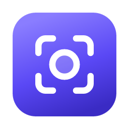

<div align="center">
  
  <h1>Glimpsfy</h1>
  <p>
    <b>Capture it, mark it up, hand it over.</b><br>
    Screenshots, screen recordings and text out of any pixel, one shortcut away in the menu bar.
  </p>
  <p>
    <a href="https://github.com/aenzenith/glimpsfy/releases/latest"><b>Download</b></a>
  </p>
  <sub>Free and open source · macOS 14+, with Windows and Linux to follow · seven languages</sub>
</div>

<br>

Taking a screenshot, marking it up and sending it usually takes three apps: one to capture, one
to draw on it and one to read the text off it, with another for screen recordings. Glimpsfy puts
the whole loop in one app. You press a key, select a region, annotate it where you took it, and
the result is on your clipboard, on your disk or behind a link within seconds.

## Features

- **Capture** takes an area, a window, a display or all displays, with a loupe, window snapping
  and a delayed mode.
- **Annotate** draws arrows, shapes, text, numbered steps, blur and pixelate on a toolbar attached
  to the selection.
- **OCR** copies the text of any region and decodes QR codes, offline through Apple's Vision
  engine.
- **Record** captures the screen with system audio and the microphone, then trims it or exports it
  as a GIF.
- **Share** copies, saves, pins or uploads a capture to a free image host, an S3 bucket or any
  ShareX endpoint.
- **History** keeps every capture and makes the text inside them searchable.

Glimpsfy has no account and no analytics, and nothing leaves your machine unless you upload it.

## Install

Download the latest build from [Releases](https://github.com/aenzenith/glimpsfy/releases/latest).

- **macOS 14+** (Apple Silicon): drag Glimpsfy from the `.dmg` to Applications. It is signed and notarised, so
  the first time, macOS asks whether to open an app downloaded from the internet; click Open. The
  first-run screen then walks you through the Screen Recording, Microphone and Accessibility
  permissions.
- **Windows and Linux** builds follow in later versions.

## Development

You need Node 22, stable Rust and the Xcode Command Line Tools.

```sh
npm ci
npm run tauri dev
cargo test --workspace && npm test
```

## Licence

[MIT](LICENSE)
